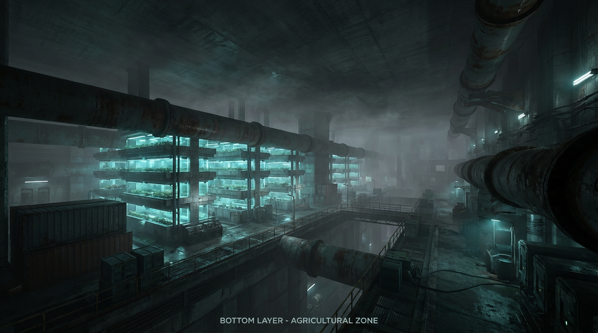
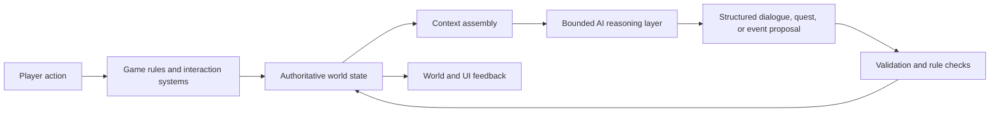

# Light（光）

  

  <strong>AI-Native Systemic Narrative RPG</strong> 
  <em>AI is part of the world, not just a content generator.</em>

  
  
  
  

Light is a closed-source Unreal Engine project by **NeonX Studio**. This repository is a curated public presentation space for the project: its setting, design principles, technical direction, and selected visual material. The game source, production assets, internal data, and development tools remain private.

## The project

Light is set in **Light City**, a three-layer underground civilization built after a surface catastrophe. The player begins as **Extro Martinez**, a maintenance worker in the agricultural layer, and gradually encounters the information controls, resource pressures, and political conflicts that keep the city operating.

The project treats the language model as a bounded **rational layer** of the simulation. It can interpret structured world state, generate context-aware dialogue and tasks, and reflect consequences through later interactions. It does not replace the game rules: resources, permissions, memories, relationships, and world-state transitions remain authoritative.

> **Systems before plot. Consequences before justice.**

## What makes Light different

- **Systemic narrative:** stories emerge from resource flows, power relationships, information asymmetry, and player actions.
- **Bounded AI:** NPC dialogue and quest generation are constrained by role, memory, attitude, available knowledge, and current world state.
- **Persistent consequences:** important interactions can change NPC memories, relationships, quest states, and regional conditions.
- **A living setting:** the player is one variable in a society that continues to operate beyond a single scripted quest line.
- **Industrial underground identity:** the visual direction favors believable engineering, maintenance wear, dust, rust, and restrained near-future technology.

## Public architecture overview

The public architecture summary is available in [`docs/ARCHITECTURE.md`](docs/ARCHITECTURE.md). It intentionally omits private prompts, credentials, service configuration, and implementation details that are not needed to understand the project direction.

## Current direction

The current development focus is a playable prototype loop that demonstrates:

1. A maintenance task in the agricultural layer.
2. NPC interaction shaped by memory, attitude, and information scope.
3. AI-assisted task or dialogue generation grounded in structured context.
4. Player actions changing world state and future interactions.
5. Persistence through saveable world, NPC, quest, and object state.

See [`docs/ROADMAP.md`](docs/ROADMAP.md) for the public milestone view and [`docs/WORLD.md`](docs/WORLD.md) for the setting summary.

## Technology

- Unreal Engine 5.8.3
- C++ gameplay systems
- Unreal subsystems, StateTree, UMG, HTTP, and JSON data workflows
- Structured data-driven NPC, quest, world-state, and interaction systems
- Optional external language-model integration through a project network subsystem

## Repository policy

This showcase repository is **not** a source-code release. The Light name, setting, design documents, visual identity, source code, game data, prompts, and production assets remain the property of NeonX Studio unless a file states otherwise.

Please do not treat this repository as a reusable game template or redistribute its media. For collaboration or licensing enquiries, contact NeonX Studio through the organization that owns this project.

## About NeonX Studio

NeonX Studio is an independent creative technology studio focused on interactive worlds, AI-native systems, and experimental game development.

- Organization: [NeonX Studio](https://github.com/NeonX-Studio)
- Private development repository: [NeonX-Studio/Light](https://github.com/NeonX-Studio/Light)
